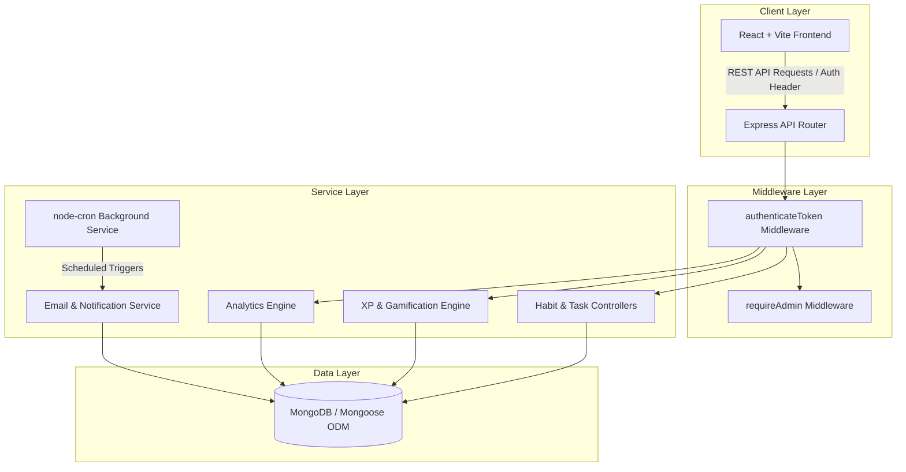

# 🚀 LifeSync: Gamified Habit Tracker & Productivity Engine
## Comprehensive Interview & Technical Documentation

---

## 📌 Executive Summary (Elevator Pitch for Interviewers)

> **"LifeSync** is a full-stack, gamified productivity and habit-tracking web application built using **Node.js, Express, TypeScript, MongoDB (Mongoose), and React (Vite)**. It transforms daily habit building, task execution, and interview preparation into an engaging, level-based RPG system.
> 
> Unlike simple static todo apps, LifeSync features a dynamic **XP & Leveling Engine**, automated background **Cron Scheduling**, **Real-Time Hydration & Reflection tracking**, **Analytics Dashboards (Streak math & weekly consistency scores)**, and **Role-Based Access Control (RBAC)**.
> 
> I built this project to solve productivity burnout by using behavioral psychology (gamification), automated reminders, and data-driven feedback loops."

---

## 1. ❓ WHY THIS PROJECT? (Problem Statement & Motivation)

### **The Problem:**
1. **App Fragmentation:** People use separate apps for habit tracking, task lists, daily journaling, hydration tracking, and interview prep. Context switching leads to drop-offs.
2. **Lack of Motivation & Discipline:** Traditional todo list apps feel like chores. Users abandon habits within 7–14 days due to a lack of immediate rewards or visual feedback loops.
3. **Inconsistent Routine Execution:** Students and developers preparing for technical interviews lack automated reminders for key daily milestones (e.g., daily LeetCode practice, morning hydration, evening reflection).

### **The Solution (LifeSync Vision):**
- **Unified Productivity Ecosystem:** Habits, tasks, goals, water intake, timeblocks, and journals in one platform.
- **Gamification Engine:** Earn XP for completing habits, unlock achievement badges (e.g., *Early Bird*, *Coding Warrior*), and level up using a square-root progression algorithm.
- **Smart Automated Routine Push:** Node-cron background jobs dispatch automated notifications and reminders for wake-up, meal times, daily coding routines, and hydration.
- **Data Insights:** Graphical visualization of weekly habit completion consistency, productivity scores, and category progress metrics (Coding vs. Interview Prep).

---

## 2. 🎯 WHAT THE PROJECT DOES (Core Features)

| Feature Module | Description & Technical Capability |
| :--- | :--- |
| **🎮 XP & Gamification Engine** | Dynamic level formula $Level = \lfloor\sqrt{XP / 100}\rfloor + 1$. Unlocks badges and awards bonus XP (e.g. +100 XP when all daily habits are completed). |
| **📊 Analytics & Consistency Engine** | Calculates average active streaks, weekly consistency percentages ($(\frac{\text{completions}}{\text{total habits} \times 7}) \times 100$), and productivity heatmaps over 7 and 30-day windows. |
| **⏱ Smart Cron Reminders** | Automated background cron schedule (`node-cron`) sending automated reminders (6 AM Wake Up, 8 AM Breakfast, 6 PM LeetCode Practice, 9 PM Reflection, Hydration every 2 hrs). |
| **✅ Habit & Task Management** | CRUD operations with target daily values, category grouping (*Coding*, *Interview Prep*, *Health*, *Study*), status toggling, and streak counters. |
| **🎯 Goal & OKR Tracker** | Target date tracking, description logging, and progress percentage updates for long-term objectives. |
| **📝 Reflective Daily Journal** | Log daily reflection notes with mood indicators and tagged entries to foster mental well-being and self-assessment. |
| **💧 Hydration Tracker** | Tracks daily water intake (target: 3.0 Litres) with incremental updates and 2-hour cron reminders. |
| **🔐 Auth & RBAC Security** | JWT-authenticated endpoints with password encryption and admin management routes to delete spam users or toggle account status. |

---

## 3. 🛠 HOW THE PROJECT WAS DONE (System Architecture & Tech Stack)

### **Architecture Diagram**



### **Tech Stack Breakdown**

- **Frontend:** React, TypeScript, Vite, Tailwind CSS / Custom CSS, Lucide Icons, Recharts.
- **Backend:** Node.js, Express.js, TypeScript.
- **Database:** MongoDB with Mongoose ODM (Object Data Modeling).
- **Scheduled Background Tasks:** `node-cron`.
- **Email Notifications:** `nodemailer` / Email Service module.
- **Security & Authentication:** `jsonwebtoken` (JWT), `bcryptjs`, CORS middleware.

---

## 4. 🗄 DATABASE SCHEMA DESIGN (MongoDB Models)

```
+-------------------+       +-------------------+       +-----------------------+
|       User        |       |       Habit       |       |    HabitCompletion    |
+-------------------+       +-------------------+       +-----------------------+
| _id               |1    * | _id               |1    * | _id                   |
| full_name         |<----->| user_id           |<----->| habit_id              |
| email             |       | name              |       | user_id               |
| password_hash     |       | category          |       | completion_date       |
| xp_points         |       | target_value      |       | completion_status     |
| current_level     |       | streak            |       | value                 |
| role (user/admin) |       | longest_streak    |       +-----------------------+
+-------------------+       +-------------------+
          |
          |1
          +-----------------+-------------------+-------------------+
          |*                |*                  |*                  |*
+-------------------+ +--------------+  +-----------------+ +-------------------+
|       Task        | |     Goal     |  |     Journal     | |   WaterIntake     |
+-------------------+ +--------------+  +-----------------+ +-------------------+
| _id               | | _id          |  | _id             | | _id               |
| user_id           | | user_id      |  | user_id         | | user_id           |
| title             | | title        |  | title           | | date              |
| priority (L/M/H)  | | progress_%   |  | content         | | litres_consumed   |
| status            | | status       |  | mood            | | target_litres     |
+-------------------+ +--------------+  +-----------------+ +-------------------+
```

---

## 5. ⚡ PAIN POINTS & TECHNICAL CHALLENGES (Interview Highlights)

When interviewing, Senior Engineers and Tech Leads love asking about **real-world engineering challenges**. Here are the 5 major pain points overcome in this project:

### **Challenge 1: Leveling Algorithm Balance & Dynamic Scaling**
- **Problem:** Using linear XP levels (e.g. 100 XP per level) makes higher levels trivial to reach early on and fails to feel rewarding later.
- **Solution:** Designed a square-root progression formula:
  $$\text{Level} = \lfloor\sqrt{\frac{\text{XP}}{100}}\rfloor + 1$$
  - *Level 1:* $0 - 99 \text{ XP}$
  - *Level 2:* $100 - 399 \text{ XP}$
  - *Level 3:* $400 - 899 \text{ XP}$
  - *Level 4:* $900 - 1599 \text{ XP}$
- **Implementation in [`xpEngine.ts`](file:///c:/Users/SUHASH%20V/OneDrive/Desktop/habit%20tracker/backend/src/services/xpEngine.ts#L31-L33):**
  ```typescript
  const newLevel = Math.floor(Math.sqrt(newXP / 100)) + 1;
  const leveledUp = newLevel > oldLevel;
  ```

---

### **Challenge 2: Preventing Cron Job Notification Duplication**
- **Problem:** When background cron jobs trigger every hour or every 2 hours, server restarts or async delays can cause duplicate notifications to be inserted into the MongoDB collection for the same user.
- **Solution:** Implemented **Idempotent Notification Insertion** by querying the database for identical notifications created in the last 60 minutes before inserting a new record.
- **Implementation in [`cronService.ts`](file:///c:/Users/SUHASH%20V/OneDrive/Desktop/habit%20tracker/backend/src/services/cronService.ts#L18-L25):**
  ```typescript
  const oneHourAgo = new Date(Date.now() - 60 * 60 * 1000);
  const existing = await Notification.findOne({
    user_id: user._id,
    title,
    created_date: { $gte: oneHourAgo }
  });
  if (!existing) {
    await Notification.create({ ... });
  }
  ```

---

### **Challenge 3: Real-Time Weekly Consistency Calculation**
- **Problem:** Computing weekly consistency across multiple habits and variable daily completions requires avoiding heavy aggregate queries that lock MongoDB documents.
- **Solution:** Utilized date-range indexed queries with normalized local ISO date strings (`YYYY-MM-DD`) and computed ratios based on expected vs. actual completions:
  ```typescript
  const weeklyConsistency = totalHabits > 0 
    ? Math.min(100, Math.round((completedPastWeek / (totalHabits * 7)) * 100)) 
    : 0;
  ```

---

### **Challenge 4: All-Habit Completion Bonus Trigger**
- **Problem:** Detecting when a user completes *all* their habits on a given day without firing duplicate +100 XP rewards when completing or toggling habits multiple times.
- **Solution:** Built `checkAllHabitsCompleted(userId, dateString)` inside `xpEngine.ts`. It compares total user habits against completed entries for `dateString`, checks if a notification with title `'All Habits Completed Today'` was created today, and atomically awards the +100 XP bonus only once.

---

### **Challenge 5: Role-Based Route Protection & JWT Lifecycle**
- **Problem:** Preventing regular users from querying or invoking administrative actions (e.g. deleting user accounts, viewing global user listings).
- **Solution:** Modularized middleware into `authenticateToken` and `requireAdmin`:
  ```typescript
  router.get('/admin/users', [authenticateToken, requireAdmin], async (req, res) => { ... });
  ```

---

## 6. 🎙 INTERVIEW Q&A CHEATSHEET (How to Answer Common Questions)

### **Q1: Why did you choose MongoDB instead of a Relational Database (PostgreSQL/MySQL)?**
> *"I selected MongoDB with Mongoose because habit completions, journals, and notifications have semi-flexible schema requirements. For instance, user achievements and notifications grow append-only, while habit daily completions are naturally indexed by `completion_date` string keys. Mongoose also allowed fast iteration while maintaining strict schema validations with TypeScript interface bindings."*

### **Q2: How do you handle authentication securely?**
> *"Authentication uses JSON Web Tokens (JWT). Upon login/registration, passwords are hashed using bcrypt. The generated token contains signed user payload data (id and role). Routes are protected via an `authenticateToken` middleware that verifies the Bearer token in HTTP authorization headers."*

### **Q3: How would you scale this app to 100,000 active daily users?**
> 1. **Database Indexing:** Ensure compound index on `{ user_id: 1, completion_date: -1 }` on `HabitCompletion` and `Notification` collections.
> 2. **Distributed Job Queue:** Replace `node-cron` with a distributed task queue like **BullMQ + Redis** so scheduled jobs run across horizontally scaled worker nodes without duplicate execution.
> 3. **Caching Layer:** Cache active user profiles, habit lists, and daily dashboard metrics in Redis with a 5-minute TTL to reduce database read load.

---

## 7. 🚀 FUTURE ENHANCEMENTS

- [ ] **Web Push Notifications:** Service Worker integration for browser desktop notifications.
- [ ] **Social Leaderboards:** Friends feed to compare level progression and habit streaks.
- [ ] **Export Data:** PDF/CSV report exporter for weekly and monthly habit performance summaries.
